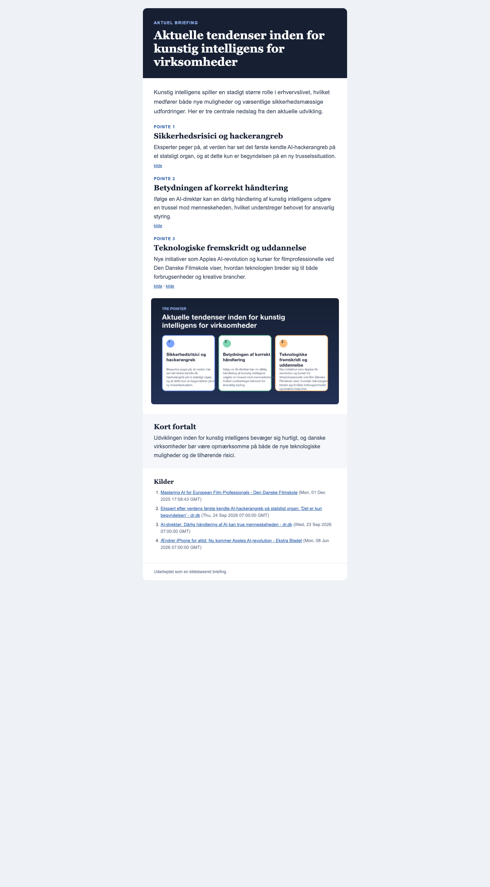

# Portfolio-case: Kildebaseret nyhedsbrev som Gmail-workflow

## Kort fortalt

Jeg har udviklet en fungerende prototype, der kan omsætte et emne til et kildebaseret dansk nyhedsbrev og levere det som en Gmail-kladde. Løsningen kombinerer AI-genereret tekst med faste valideringsregler, lokal grafik, e-mailrendering og en sikker godkendelse før afsendelse.

Casen er et selvstændigt lærings- og portfolio-projekt. Den er ikke udviklet for en kunde og har endnu ikke været anvendt i en organisations drift.

## Behovet

Udgangspunktet var en gentagen kommunikationsopgave:

1. Find aktuelle og relevante historier om et bestemt emne.
2. Udvælg troværdige danske kilder.
3. Saml dem i en kort og læsbar briefing.
4. Tilføj en enkel visuel opsummering.
5. Klargør mailen uden at sende noget ukontrolleret.

Den centrale udfordring var derfor ikke blot at få en sprogmodel til at skrive tekst, men at opbygge et workflow med tydelige input, stopkriterier, sporbare kilder og menneskelig kontrol.

## Min tilgang

Jeg strukturerede løsningen efter WAT-princippet:

- **Workflow:** En skriftlig proces beskriver rækkefølge, kvalitetskrav og fejlhåndtering.
- **Agent:** AI anvendes til at sammenfatte og formulere indhold på baggrund af de tilladte kilder.
- **Tools:** Python håndterer feeds, validering, grafik, MIME-format, Gmail og logning.

Det betyder, at AI ikke selv bestemmer, hvilke URL'er der er tilladt, om der er nok kilder, eller om en mail skal sendes. De beslutninger håndhæves i kode.

## Løsningen

Prototypen:

- modtager emne, vinkel, målgruppe og tone
- søger via Google News RSS med fokus på danske udgivere
- filtrerer efter domæne, dato, relevans, sprog og dubletter
- sender kun det godkendte kildemateriale videre til Gemini
- kræver struktureret output med tre hovedpointer og kilde-ID'er
- afviser ukendte eller dublerede kilder
- genererer en lokal infografik
- renderer både HTML og tekstfallback
- samler indhold og billede i en MIME-mail
- opretter som standard en Gmail-kladde til menneskelig gennemgang

## Test og iteration

Jeg har brugt automatiske tests til både normale og fejlagtige scenarier. Den aktuelle version består 18 tests.

En vigtig fejl opstod først i det virkelige slutled: Infografikken fandtes i den lokale mail og i kladden, men blev ikke vist efter afsendelse. Undersøgelsen viste, at en anden Gmail-forbindelse rekonstruerede HTML’en uden den tilhørende billeddel. Jeg ændrede derfor løsningen, så den oprindelige rå MIME-kladde sendes gennem samme Gmail API-session. En ny testmail blev derefter kontrolleret og indeholdt den forventede inline PNG og det korrekte Content-ID.

Fejlen lærte mig, at en lokal test ikke er nok for en integration. Det faktiske resultat hos modtageren skal også verificeres.

## Hvad casen demonstrerer

- Behovsafgrænsning og procesforståelse
- Opdeling mellem AI-baseret og deterministisk arbejde
- API- og OAuth-integration
- Datavalidering og stopkriterier
- Kildebevidst anvendelse af generativ AI
- Fejlsøgning på tværs af kode og ekstern tjeneste
- Test, dokumentation og sikker menneskelig godkendelse

## Begrænsninger

Prototypen er bevidst lille. Den har ikke abonnentstyring, automatisk planlægning, statistik, afmelding eller en brugergrænseflade. Feedets uddrag kan heller ikke erstatte læsning af hele artikler. Før brug i en rigtig organisation skal indhold, databehandling, ansvar, godkendelsesproces og e-mailregler afklares med organisationen.

## Relevant næste skridt

Det næste meningsfulde skridt er ikke automatisk masseudsendelse. Det er en afgrænset pilot med én mindre organisation:

1. Afdæk deres eksisterende kommunikationsproces.
2. Vælg ét emne og én fast modtager til intern test.
3. Definér redaktionelle regler og godkendelsesansvar.
4. Kør et lille antal kontrollerede udgaver.
5. Vurdér tidsbesparelse, kvalitet og nødvendige ændringer.

Det vil gøre det muligt at dokumentere reel anvendelse og organisatorisk værdi uden at fremstille læringsprojektet som mere modent, end det er.

## Kort præsentation til en samtale

> Jeg byggede prototypen for at undersøge, hvordan en gentagen kommunikationsopgave kan automatiseres ansvarligt. AI skriver ikke frit og sender ikke selv. Python-koden filtrerer kilderne, validerer outputtet og stopper ved fejl, mens en person godkender Gmail-kladden. Under testen opdagede jeg, at infografikken forsvandt i selve afsendelsen, selv om den lokale mail var korrekt. Jeg fulgte fejlen gennem MIME-strukturen, ændrede integrationen og verificerede resultatet i den modtagne mail. For mig viser projektet især samspillet mellem behov, workflow, teknik og kvalitetssikring.
