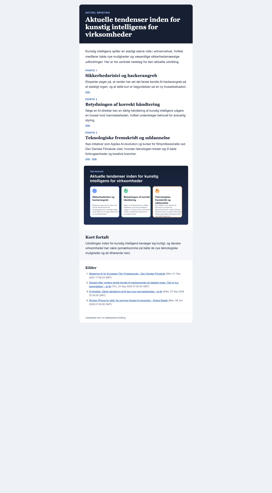

# Nyhedsbrev demo

Et lokalt Python-workflow, der finder aktuelle danske nyhedskilder, bruger Gemini til at udforme et kort dansk nyhedsbrev, genererer en infografik og opretter resultatet som en Gmail-kladde. Afsendelse er et særskilt, eksplicit valg.

Projektet er bygget som en portfolio-case i workflowdesign, API-integration, validering og kvalitetssikring. Det er en fungerende prototype og ikke en færdig masseudsendelsesplatform.



## Problemet

Det tager tid at finde relevante historier, kontrollere kilder, skrive en kort briefing og formatere den til e-mail. Demoen undersøger, hvor stor en del af den proces der kan automatiseres, uden at give afkald på kildekrav og menneskelig godkendelse før udsendelse.

## Sådan virker løsningen

```text
Emne og målgruppe
       ↓
Google News RSS → filtrering af danske, aktuelle og relevante kilder
       ↓
Gemini → struktureret JSON med præcis tre hovedpointer
       ↓
Validering → kilder, URL'er, felter og kildehenvisninger kontrolleres
       ↓
Lokal PNG + HTML + tekstfallback + MIME-mail
       ↓
Gmail-kladde → valgfri, udtrykkeligt godkendt testafsendelse
```

AI bruges til den sproglige bearbejdning. Kildekontrol, validering, rendering, Gmail-integration og fejlhåndtering udføres af deterministisk Python-kode.

## Centrale funktioner

- Henter kilder fra et offentligt Google News RSS-feed.
- Accepterer kun aktuelle kilder fra danske `.dk`-udgivere.
- Afviser dubletter, ugyldige datoer, irrelevante resultater og tydelige norske sprogformer.
- Kræver mindst tre forskellige kilder og præcis tre hovedpointer.
- Begrænser Gemini til kilder fra det validerede feed.
- Genererer en lokal infografik på 1200 × 675 pixels uden billed-API.
- Opretter HTML, tekstfallback og en MIME-mail med inline PNG.
- Opretter som standard kun en Gmail-kladde.
- Kræver det eksplicitte flag `--send` for afsendelse.
- Gemmer et manifest for hver kørsel uden at logge nøgler eller mailindhold.

## Sikker lokal demonstration

Dry-run bruger fixtures og foretager ingen netværkskald, Gemini-kald eller Gmail-ændringer:

```bash
python3 -m venv .venv
.venv/bin/python -m pip install -r requirements.txt
.venv/bin/python -m tools.create_newsletter \
  --topic "Kunstig intelligens i danske virksomheder" \
  --dry-run
```

Resultatet gemmes i `.tmp/<run-id>/` som researchdata, PNG, HTML, tekst, EML og manifest.

`tools.render_preview` kan lave en lokal browserpreview af et allerede genereret resultat til dokumentation og visuel kontrol:

```bash
.venv/bin/python -m tools.render_preview .tmp/<run-id> portfolio-assets
```

## Test

```bash
.venv/bin/python -m unittest discover -v
```

Den verificerede version består 18 tests, blandt andet for kildefiltrering, skemavalidering, HTML-escaping, MIME-struktur, inline-billede, modtagervalidering og sikker dry-run.

## Livekonfiguration

Kopiér `.env.example` til `.env`, og tilføj lokale værdier. Google OAuth-oplysninger placeres i `credentials.json`. Filerne `.env`, `credentials.json`, `token.json`, `.venv/` og `.tmp/` er ignoreret og må ikke deles.

En livekørsel bruger Gemini og opretter en Gmail-kladde. `--send` må kun anvendes efter konkret godkendelse af modtageren.

## Kvalitet og begrænsninger

- Nyhedsfeedets metadata og uddrag er ikke det samme som fuld artikelresearch.
- AI-genereret tekst bør gennemgås af et menneske før ekstern brug.
- Prototypen understøtter kun én modtager og er ikke et abonnementssystem.
- Der er ingen database, administrationsflade, åbningsstatistik eller afmeldingsfunktion.
- Planlagt drift, masseudsendelse og persondatahåndtering kræver yderligere design og compliance.
- E-mailvisning kan variere mellem mailklienter og bør testes før produktion.

## Min rolle og læring

Jeg har afgrænset workflowet, konkretiseret kvalitetskravene og itereret på løsningen gennem test. Under en rigtig testafsendelse blev infografikken ikke leveret korrekt, fordi mailen blev rekonstrueret gennem en anden Gmail-forbindelse. Fejlen blev lokaliseret til afsendelsesvejen. Løsningen blev ændret, så den samme Gmail API-session sender den gemte rå MIME-kladde. Den efterfølgende mail blev verificeret med `image/png`, inline-disposition og korrekt Content-ID.

Arbejdet har især givet praktisk erfaring med at omsætte et behov til et afgrænset workflow, skelne mellem AI-opgaver og deterministisk kode, opstille stopkriterier og teste en integration på det faktiske slutresultat.

Se den korte arbejdsgiverrettede case i [PORTFOLIO_CASE.md](PORTFOLIO_CASE.md).

Udviklere kan læse [arkitekturoverblikket](ARCHITECTURE.md) og [bidragsvejledningen](CONTRIBUTING.md).
